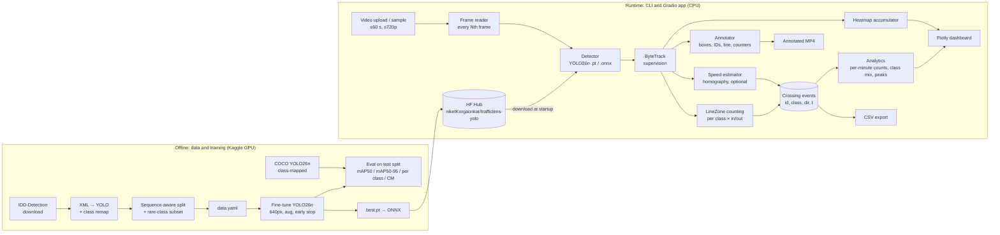

# TrafficLens — Phase 0 Plan

_Status: draft for review (Phase 0). Last updated 2026-11-02._

## 1. Toolchain (checked against PyPI on 2026-11-02)

| Component | Version | Notes |
|---|---|---|
| Python | 3.11 | |
| `ultralytics` | 8.4.x (latest 8.4.198) | AGPL-3.0. **YOLO26** is the current release (YOLO27 is announced, but there are no weights yet). YOLO11 is the mature fallback. |
| `supervision` | 0.31.x | ByteTrack, `LineZone`, `HeatMapAnnotator`, box/label/trace annotators |
| `gradio` | 6.x | HF Spaces SDK |
| `roboflow` | 1.7.x | Dataset download, only if we pick a Roboflow dataset |
| `opencv-python-headless`, `pandas`, `plotly`, `pyyaml`, `pytest` | latest | |

**Model choice: `yolo26n` (fine-tuned), with `yolo26s` as a stretch goal.** YOLO26 is NMS-free and tuned for CPU/edge inference, which suits a free CPU Space. The COCO baseline uses the same architecture (`yolo26n.pt`, COCO-pretrained), so the comparison isolates the effect of the data. If YOLO26 gives trouble with ONNX export or tracking, fall back to `yolo11n` and run both arms of the comparison on it.

**Licensing:** Ultralytics is AGPL-3.0, so this repo is public under AGPL-3.0 (`LICENSE` was added in the first commit). The dataset licence is separate and also applies to the trained weights (see §2).

## 2. Dataset comparison and recommendation

### Candidates

| # | Dataset | Images | Relevant classes | Licence | Viewpoint | Access |
|---|---|---|---|---|---|---|
| A | **IDD-Detection** (IIIT Hyderabad), [idd.insaan.iiit.ac.in](https://idd.insaan.iiit.ac.in/dataset/details/) | 46,588 (31,569 train / 10,225 val; test labels not released) | car, bus, truck, **autorickshaw**, motorcycle, bicycle, person, rider (+ caravan, trailer, vehicle fallback, animal, signs, lights, train) | Shown at download after registration. Research / non-commercial terms; to be confirmed | Dash-cam (ground level, Hyderabad + Bengaluru) | Free registration. Pascal-VOC-style XML, about 20 GB |
| B | **Traffic-Indian-Vehicles** (Roboflow, `car-detection-bhgrt/traffic-indian-vehicles-tpjem`) | 3,001 (2,103 / 596 / 302) | car, bus, truck, bicycle, motorbike, scooter, **auto rickshaw**, rickshaw, three wheelers-CNG, van, taxi, suv, minibus, pickup, ambulance … (21) | Not visible to me; Roboflow shows it on the page | Mixed street/CCTV, Indian **and Bangladeshi** sources | Roboflow API, YOLO format |
| C | **indian_traffic** (Roboflow, `project-1-ryhzx/indian_traffic-q7vlo`) | 4,680 (3,626 / 749 / 305) | Class list not shown in the snippets I could read | Not visible | Unknown | Roboflow API |
| D | **Indian_vehicles_detection** (Roboflow, `thesis-3hyue/indian_vehicles_detection`) | 5.8k | Car, Bus, Bike, **Auto-Rickshaw**, HCV, LCV, Toto | Not visible | Mixed | Roboflow API. No pedestrian or bicycle class |
| E | **ITAWD** (Roboflow, `shilpa-mocpz/itawd`) | 10k on Roboflow (24k in the paper) | 47 classes including Car, Bus, Truck, Motorcycle, Bicycle, Rickshaw, Person, Rider, plus signs and potholes. **Part of it is IDD**, partly filmed in Mumbai | Not visible. Inherits IDD terms | Dash-cam | Roboflow API |
| F | DriveIndia / TiAND (IIT Hyderabad) | 66,986 | 24 classes including autorickshaw | Academic, non-commercial | Dash-cam | "Will be released". Not reliably available yet |

### Caveats

- The sandbox I run in **cannot reach** `universe.roboflow.com`, `api.roboflow.com`, `kaggle.com`, `huggingface.co` or the IDD site, so I could not open licence fields or sample images. Image counts and classes above come from search-index snapshots of the pages. Before we commit to a dataset, you (or the Phase 1 script, using your key) should confirm the licence.
- Most Roboflow Indian-traffic sets are small student projects. Their class names are inconsistent (Bike, MotorBike, motorbike; Rickshaw vs Auto-Rickshaw vs Toto vs CNG). Their published mAPs are low (B: 37.7 % mAP50), which suggests noisy labels. Several mix in Bangladeshi data (CNG, rickshaw-van, leguna).
- A Kaggle mirror of IDD-D in YOLO format exists ([redzapdos123](https://www.kaggle.com/datasets/redzapdos123/indian-driving-dataset-detections-yolov11), 41,962 images, CC BY-NC-SA 4.0). It is a third-party re-upload, so I'd only use it with the official licence's blessing. It would let the Kaggle notebook skip a 20 GB upload.

### Recommendation: **A, IDD-Detection, subsampled**

1. **Credibility.** IDD is a published, peer-reviewed benchmark (WACV 2019) with consistent labels. "Fine-tuned on IDD" means something to a reviewer; "fine-tuned on a Roboflow student project" doesn't.
2. **Class coverage.** It is the only candidate with every class we need (car, bus, truck, autorickshaw, motorcycle, bicycle, person) plus `rider`, which matters for not double-counting people on two-wheelers.
3. **Scale and density.** Dense, mixed, occluded scenes from Indian cities are exactly the story we want to tell.
4. **Kaggle-friendly.** We train on a stratified subset of about 15–20k train images, keeping every image that contains autorickshaws or bicycles, so a `yolo26n` run of about 60 epochs at 640 fits within Kaggle's 12 h GPU session. The official **val split becomes our test split** (labels for IDD's own test split are not public). We carve our own val split from train, **by drive sequence**, to avoid leaking near-duplicate frames.

**Known risk: viewpoint gap.** IDD is dash-cam footage, and your clips will be from a footbridge (elevated, looking down). Expect lower detection quality on your clips than the test-set mAP suggests. Mitigations, in order of effort:
- (a) Report it honestly as a limitation; the counting-accuracy table measures the real impact.
- (b) Add one elevated or CCTV-view Roboflow set as a small supplement if its licence is CC BY 4.0.
- (c) Label 150–300 frames from your own Mumbai clips (Roboflow annotate) and fine-tune for a few more epochs. This is the strongest portfolio story, but only if time allows.

**Licence consequence.** If the IDD terms are non-commercial, the **fine-tuned weights inherit that**. The HF model card will say "weights for non-commercial / research use, trained on IDD (cite paper)". The code stays AGPL-3.0. That is fine for a portfolio.

**Fallback if you'd rather not register for IDD:** B (Traffic-Indian-Vehicles) merged with D, licences permitting. The downside is noisier labels, and the baseline-vs-fine-tuned comparison would be less convincing.

## 3. Final class list

| id | TrafficLens class | IDD source classes | COCO baseline mapping |
|---|---|---|---|
| 0 | `car` | car (+ caravan → car) | car (2) |
| 1 | `bus` | bus | bus (5) |
| 2 | `truck` | truck, trailer | truck (7) |
| 3 | `auto_rickshaw` | autorickshaw | **none**: COCO has no such class. The baseline scores 0 AP by construction, and we also report which COCO class autos get detected as (usually car or motorcycle) |
| 4 | `two_wheeler` | motorcycle (motorbikes and scooters) | motorcycle (3) |
| 5 | `bicycle` | bicycle | bicycle (1) |
| 6 | `pedestrian` | person | person (0) — see note |

Dropped: `rider` (people on a two-wheeler or bicycle; counting them would double-count the vehicle), `vehicle fallback` (ambiguous), `animal`, `train`, traffic signs and lights.

Notes:
- COCO `person` fires on riders too, while IDD labels them `rider`. The baseline's `pedestrian` precision is therefore penalised partly because of a label-definition difference. I'll report it with that footnote instead of hiding it.
- I expect imbalance like car ≫ two_wheeler > auto_rickshaw ≫ bicycle. Phase 1 will show the real counts. If needed, mitigate with image-level oversampling of rare classes in the subset selection, not loss hacks.
- The class list and every mapping live in `configs/classes.yaml`, so swapping datasets only touches config.

## 4. Repository structure

```
trafficlens/
├── LICENSE                     # AGPL-3.0
├── README.md
├── pyproject.toml              # package + deps, `pip install -e .`
├── requirements.txt            # pinned, for HF Spaces
├── .env.example                # ROBOFLOW_API_KEY, HF_TOKEN
├── configs/
│   ├── classes.yaml            # final classes + source→target remaps + COCO map
│   ├── data.yaml               # dataset paths, subset sizes, split seed
│   ├── train.yaml              # model, epochs, imgsz, augmentation, patience
│   └── app.yaml                # conf/iou thresholds, tracker params, line, frame skip, upload limits, speed calib
├── src/trafficlens/
│   ├── __init__.py
│   ├── config.py               # typed config loading (dataclasses)
│   ├── data/
│   │   ├── download.py         # dataset download (IDD manual / Roboflow API)
│   │   ├── remap.py            # class remapping (pure, unit-tested)
│   │   ├── convert.py          # IDD XML → YOLO txt
│   │   ├── split.py            # sequence-aware train/val/test split
│   │   └── stats.py            # class distribution plots
│   ├── detect.py               # Detector wrapper (pt / onnx), returns sv.Detections
│   ├── track.py                # ByteTrack wrapper
│   ├── count.py                # line-crossing + direction logic (pure, unit-tested)
│   ├── analytics.py            # time series, class mix, peaks, heatmap, CSV
│   ├── speed.py                # homography + km/h estimation (approximate)
│   ├── annotate.py             # drawing boxes / IDs / line / counters
│   ├── pipeline.py             # glue: video in → annotated video + events
│   ├── run.py                  # CLI: python -m trafficlens.run --video in.mp4 --line x1,y1,x2,y2
│   └── eval/
│       ├── baseline.py         # COCO-pretrained vs fine-tuned on same test split
│       ├── counting.py         # manual vs system counts, abs/% error
│       └── benchmark.py        # FPS on CPU/GPU, PyTorch vs ONNX
├── app/
│   ├── app.py                  # Gradio UI (HF Space entry point)
│   └── samples/                # sample clip metadata (videos fetched at startup)
├── notebooks/
│   └── train.ipynb             # Kaggle GPU training notebook
├── scripts/                    # thin wrappers (prepare_data.py, export_onnx.py, upload_hf.py)
├── tests/
│   ├── test_remap.py
│   ├── test_count.py           # line crossing + direction
│   └── test_speed.py
├── docs/
│   ├── PLAN.md                 # this file
│   └── assets/                 # plots, sample frames, demo GIF (small files only)
└── reports/                    # metrics JSON/CSV committed from runs (small)
```

## 5. Architecture



## 6. Evaluation plan

1. **Detection** (`eval/baseline.py`): COCO `yolo26n.pt` vs fine-tuned `yolo26n` on the same test split, with the same imgsz and thresholds. COCO predictions are remapped through `classes.yaml`. Report mAP50 and mAP50-95 overall and per class, plus confusion matrices, with `auto_rickshaw` and `two_wheeler` highlighted. Because the baseline has no auto-rickshaw class, I report the overall mAP **both** over all 7 classes and over the 6 classes COCO shares, so the gain isn't only "we added a class".
2. **Counting accuracy** (`eval/counting.py`): your 3 clips, 1–2 minutes each, manual counts per class and direction against the system counts. Report absolute and % error.
3. **Speed** (`eval/benchmark.py`): FPS for PyTorch CPU, ONNX CPU (in the Space or locally) and GPU (in the notebook). Report end-to-end pipeline FPS as well as model-only FPS.
4. **Speed estimation:** sanity-checked on a clip with a known-length road marking. Labelled approximate everywhere.

## 7. Phase checklist

- [x] **Phase 0** — plan (this doc), licence, gitignore, `.env.example`
- [ ] **Phase 1** — data prep: download/convert/remap/split, class-distribution plots, `data.yaml`, remap tests
- [ ] **Phase 2** — `notebooks/train.ipynb` (Kaggle) + `eval/baseline.py` → you run training, return `best.pt` + metrics
- [ ] **Phase 3** — detect + ByteTrack + line counting module + CLI + tests
- [ ] **Phase 4** — analytics, heatmap, CSV, optional speed
- [ ] **Phase 5** — Gradio app
- [ ] **Phase 6** — counting eval, ONNX, README, HF model repo + Space deploy

## 8. Open questions for you

1. **Dataset:** OK to register for IDD and go with option A? If yes, after registering, please paste the licence text shown at download, or tell me its name.
2. **Where Phase 1 runs:** my sandbox can't reach Roboflow, Kaggle, HF or IDD, so I can't download data here. My plan is to write the data-prep scripts and tests here (tested on a tiny synthetic fixture) and run them as the first cells of the Kaggle notebook, so the data never has to leave Kaggle. Phase 1's distribution plots would then come from your first Kaggle run. The alternative is to allow those domains in this environment's network settings so I can run Phase 1 myself.
3. **IDD on Kaggle:** either upload the official IDD-D archive as a *private* Kaggle dataset (about 20 GB, one-time), or use the YOLO mirror if the official licence permits it.
